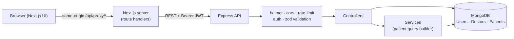

# Doctor Tracker — Backend API

## Elevator Pitch

Doctor Tracker is a secure admin portal for managing doctors and their patients. This repository is the **standalone REST API** behind it: an Express + MongoDB server that handles authentication, doctor and patient CRUD, and the aggregation queries that power the analytics dashboard. It is built around query performance: every list endpoint paginates, searches and filters through purpose-built compound indexes, and the dashboard is computed with MongoDB aggregation pipelines instead of in application code.

> Frontend repository: https://github.com/R4PTORxAR4F4T/doctor-tracker-frontend
> Server Live API: https://doctor-tracker-frontend-flame.vercel.app/login (`GET /api/health`)

---

## Setup Guide

**Prerequisites:** Node.js 18+ and a MongoDB instance (local, Docker, or a free MongoDB Atlas cluster).

```bash
# 1. Install dependencies
npm install

# 2. Configure environment
cp .env.example .env

# 3. (Optional) start a local MongoDB with Docker
docker compose up -d

# 4. (Optional) load demo data: 14 doctors, 160 patients spread over ~75 days
npm run seed

# 5. Run the API
npm run dev                 # http://localhost:5000  (auto-restart on change)

```

The admin account is created automatically on boot from `ADMIN_EMAIL` / `ADMIN_PASSWORD` if it does not exist yet. Verify with `curl http://localhost:5000/api/health`.

### Environment variables (`.env.example`)

| Variable                                      | Required | Description                                                                        |
| --------------------------------------------- | -------- | ---------------------------------------------------------------------------------- |
| `MONGODB_URI`                                 | yes      | MongoDB connection string                                                          |
| `JWT_SECRET`                                  | yes      | Long random string used to sign tokens                                             |
| `JWT_EXPIRES_IN`                              | no       | Token lifetime (default `1d`)                                                      |
| `CLIENT_URL`                                  | no       | Comma-separated allowed browser origins for CORS (default `http://localhost:3000`) |
| `ADMIN_NAME`, `ADMIN_EMAIL`, `ADMIN_PASSWORD` | no       | Admin account created on boot if missing                                           |
| `PORT`                                        | no       | Default `5000`                                                                     |

Default demo login (from `.env.example`): `admin@doctortracker.com` / `Admin@12345`. **Change it for any real deployment.**

### Deploying

- **Render (recommended, free tier):** a `render.yaml` blueprint is included. Build `npm install`, start `npm start`, health check `/api/health`. Free instances sleep after ~15 min of inactivity, so the first request can take up to a minute.
- **Vercel:** `api/index.js` + `vercel.json` expose the Express app as a serverless function (the DB connection is cached across invocations).
- Use a MongoDB Atlas free cluster and allow the host's IPs under _Network Access_.

---

## System Architecture



**Request lifecycle:** `helmet/cors/compression/rate-limit` → route → `protect` (verify JWT) → `authorize('admin')` → `validate(zod schema)` (body or query, values are coerced and unknown fields stripped) → controller → Mongo → JSON. Any thrown error reaches one central `errorHandler`, which maps Mongoose validation errors, duplicate keys (409), bad ids (400) and JWT failures (401) to a consistent `{ success:false, message, errors[] }` shape.

**Folder structure**

```
src/
  config/        env validation, cached Mongo connection
  models/        User, Doctor, Patient (+ indexes)
  validators/    zod schemas for bodies and query strings
  middleware/    auth (protect/authorize), validate, error handling
  controllers/   auth, doctors, patients, dashboard
  services/      patientService (shared filter/pagination builder)
  routes/        one router per resource
  scripts/seed.js
api/index.js     Vercel serverless entry
```

**Data model**

```
Doctor  1 ──── * Patient          Patient.doctor → Doctor._id   (deleting a doctor cascades)
User              (admins; passwords bcrypt-hashed, select:false)
```

### API reference

All routes except `/api/health` and `POST /api/auth/login` require `Authorization: Bearer <token>` and the `admin` role.

| Method             | Endpoint                               | Purpose                                                                                                 |
| ------------------ | -------------------------------------- | ------------------------------------------------------------------------------------------------------- |
| POST               | `/api/auth/login`                      | Email + password → `{ token, user }` (rate limited)                                                     |
| GET                | `/api/auth/me`                         | Current user                                                                                            |
| GET                | `/api/dashboard?days=30`               | Totals, trend, patients per doctor, registrations over time, condition/status/specialization breakdowns |
| GET                | `/api/doctors`                         | List with `search, specialization, hospital, from, to, sort, page, limit`                               |
| GET                | `/api/doctors/meta` · `/options`       | Distinct filter values · `{id, name}` list for dropdowns                                                |
| POST               | `/api/doctors`                         | Create (`name, specialization, hospital, phone, email`)                                                 |
| GET / PUT / DELETE | `/api/doctors/:id`                     | Read (with `patientCount`) / update / delete + cascade                                                  |
| GET                | `/api/doctors/:id/patients`            | That doctor's patients (same filters as the patients list)                                              |
| POST               | `/api/doctors/:id/patients`            | Add a patient under a doctor                                                                            |
| DELETE             | `/api/doctors/:id/patients/:patientId` | Remove a patient from the doctor's list                                                                 |
| GET                | `/api/patients`                        | List with `search, condition, status, gender, doctor, from, to, sort, page, limit`                      |
| GET                | `/api/patients/meta`                   | Distinct conditions                                                                                     |
| POST               | `/api/patients`                        | Create (requires `doctor`)                                                                              |
| GET / PUT / DELETE | `/api/patients/:id`                    | Read / update / delete                                                                                  |

List responses: `{ success, data: [...], meta: { total, page, limit, totalPages } }`. Dates (`from`, `to`) are inclusive `YYYY-MM-DD` filters on `createdAt` (UTC).

---

## Technical Decisions

### 1. Compound indexes shaped around "filter + sort + paginate"

Every list screen runs the same shape of query: an optional equality filter (`specialization`, `hospital`, `doctor`, `status`, `condition`), a date range on `createdAt`, a sort, then `skip/limit`. A single-field index per column would let Mongo use the filter but then sort in memory. Instead each filter field is paired with the default sort key:

```js
Doctor:  { createdAt:-1, _id:-1 }  { specialization:1, createdAt:-1 }  { hospital:1, createdAt:-1 }  { name:1, _id:1 }
Patient: { doctor:1, createdAt:-1, _id:-1 }  { createdAt:-1, _id:-1 }  { condition:1, createdAt:-1 }  { status:1, createdAt:-1 }  { name:1, _id:1 }
```

Supporting choices:

- `_id` is a sort tie-breaker, so pages never skip or repeat rows when many documents share a timestamp.
- Results use `.lean()` and the count runs in parallel with the page query (`Promise.all`).
- **No N+1:** the doctors list needs a patient count per doctor. One grouped aggregation `$match { doctor: {$in: pageIds} } → $group` (served by the `{doctor, createdAt}` index) replaces a count query per card.
- Dashboard: `estimatedDocumentCount()` for totals (metadata read, O(1)), `$group` pipelines for breakdowns, and `$lookup` is applied **after** `$sort/$limit` so only the top 10 doctors are joined. Time series are bucketed with `$dateToString`, then gaps are filled server-side so charts get a continuous axis.

**Trade-off:** `skip/limit` gets slower at very deep offsets; for this dataset size it is the right UX (numbered pages). A keyset cursor (`createdAt < last`) is the upgrade path for huge collections.

### 2. Case-insensitive regex search (and what I would change at scale)

Search must match partial words while typing ("car" → "Cardiology"). MongoDB `$text` indexes only match whole stems, so they fail that requirement. The implementation therefore uses an escaped, case-insensitive regex across a few fields, combined with the indexed filters and date range so the candidate set is already narrowed.

- Input is passed through `escapeRegex`, which prevents regex injection and ReDoS via user input; length is capped at 100 chars by validation.
- An unanchored regex cannot use an index, so this is a bounded scan, not an index seek. That is fine for thousands of rows and I am explicit that it will not scale to millions.
- **Scale path:** MongoDB Atlas Search (autocomplete/edgeNgram analyzer), or a denormalised lowercase `searchKey` with an anchored-prefix index.

### Security notes

bcrypt (cost 12) password hashing; JWT with expiry; identical error for unknown email vs wrong password; login rate limiting plus a global limiter; `helmet`; CORS allow-list; 100 KB body limit; zod validation on every body/query/id; production errors hide internals.

---

## Visual Evidence

UI screenshots (desktop and mobile) live in the **frontend repository** README. API behaviour can be checked live at `GET /api/health`.

---

## Notes and known limitations

- Single role (`admin`); the `authorize()` middleware is in place for adding more.
- JWTs are stateless: there is no server-side revocation list (a deleted admin keeps access until the token expires).
- No automated test suite is included yet; validation and error paths were designed to be easy to cover with `supertest` + `mongodb-memory-server`.
  # doctor-tracker-backend
  
  
